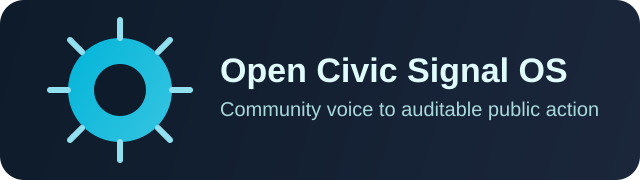
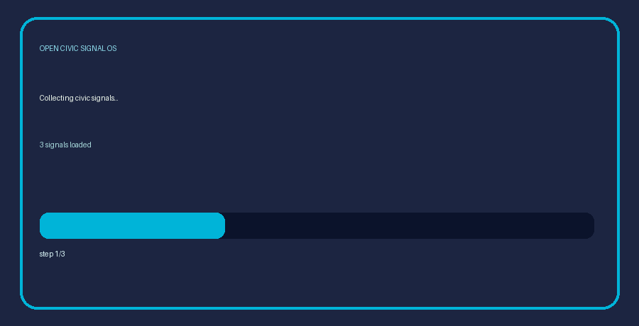

<p align="center">
  
</p>

<h1 align="center">Open Civic Signal OS</h1>

<p align="center">
  <strong>Turn community feedback into a transparent, auditable public backlog.</strong><br />
  Report a local problem, see why it ranks, and follow who responds.
</p>

<p align="center">
  <a href="https://open-comunity.eridu.top"></a>
  
  
  
</p>

<p align="center">
  <a href="https://open-comunity.eridu.top"><strong>▶ Open the live site</strong></a>
  ·
  <a href="docs/DEPLOY_PRODUCTION.md">Deploy</a>
  ·
  <a href="https://github.com/jdsalasca/open-civic-signal-os/issues">Issues</a>
  ·
  <a href="docs/IMPLEMENTATION_PLAYBOOK.md">Playbook</a>
</p>

<p align="center">
  
</p>

## Why this exists

Local problems repeat because the record is scattered: a chat, a form, a meeting, a promise. Open
Civic Signal OS gives a community one shared, public backlog where every item is traceable and every
priority can be explained.

**The promise for a resident:** report a real problem, see why it was prioritized, and follow what
changed and who responded. **For public servants:** reduce noise, act on what matters first, and
justify the order with visible evidence.

## Try it

1. Open **https://open-comunity.eridu.top** and continue with Google. Production is Google-only; no
   password is stored.
2. Choose your city, locality and neighborhood (or create the barrio). You can use your location and
   the closest city is proposed.
3. Report a problem, support an existing one, and follow the public backlog. Proposals and votes let
   the community decide together.

The interface starts in your browser's language (Spanish or English) and can be changed any time from
the gear in the top bar or **Settings**. Three visual styles: light, dark and high contrast.

## What it does

| Capability | What the community gets |
|---|---|
| Public backlog | A ranked list readable without an account, with the formula and the last update time |
| Explainable score | `(Urgency × 30) + (Impact × 25) + min(People/10, 30) + min(Votes/5, 15)` and per-item terms |
| Places | City → locality → neighborhood, normalized in the backend; an empty barrio becomes inactive |
| Reports | Evidence, location, urgency, impact, people affected, and an auditable timeline |
| Proposals and votes | Structured proposals with YES/NO or 1–5 voting, eligibility rules and a tally |
| Roles | Citizen, moderator, coordinator, public-servant liaison, super admin, with explicit boundaries |
| Governance | Decision ledger, governance library, project boards, open-data exports and trust metrics |
| Accessibility | Keyboard-first navigation, semantic landmarks, WCAG AA contrast in all three themes |

## Stack

- **Backend:** Java 21 + Spring Boot, PostgreSQL 15 + Flyway, JWT, Google Identity Services.
- **Frontend:** React + TypeScript + Vite, PrimeReact, SCSS tokens, three themes.
- **Contracts:** OpenAPI in `packages/contracts`.
- **Runtime:** Docker Compose for dev and production.

## Monorepo layout

```
apps/api-java       Spring Boot API, scoring, communities, moderation
apps/web-react      Public landing, dashboard, operator console
packages/contracts  OpenAPI contract
infra               Compose files, deployment scripts, env examples
docs                Strategy, architecture, ADRs, evidence
scripts             Quality gates and operational tooling
```

## Quick start

The canonical integrated runtime is Docker (hot reload for web and API):

```bash
npm run docker:dev:up
```

- Web: http://localhost:5173 · API: http://localhost:8081 · Mailpit: http://localhost:8025
- Doctor: `npm run docker:dev:doctor`
- Logs: `npm run docker:dev:logs`
- Stop: `npm run docker:dev:down`

If Docker is unavailable, treat it as a blocker rather than silently switching to a non-Docker stack
when validating integrated behavior.

### Quality gates

```bash
npm run agent:preflight      # context, backlog, secrets, build, Java tests, contract parity
npm test                     # deterministic ranking and ingest scripts
npm run check:contrast       # 102 token pairs across the three themes (WCAG AA)
cd apps/api-java && mvn test # 475 backend tests
cd apps/web-react && npx playwright test
```

## Engineering principles

- Ranking is deterministic and backend-owned; the frontend only renders it.
- Raw input and derived output are stored separately; scoring never mutates source records.
- Every processing run is idempotent and fails fast on invalid input.
- PII is minimized at ingest and anonymized before public dashboards.
- Every ranked item exposes its inputs and the version of the rule that produced it.
- Human-in-the-loop: the algorithm suggests, people decide.

## Documentation

- [Production deploy](docs/DEPLOY_PRODUCTION.md)
- [Implementation playbook](docs/IMPLEMENTATION_PLAYBOOK.md)
- [Definition of done](docs/DEFINITION_OF_DONE.md)
- [Security baseline](docs/SECURITY_BASELINE.md)
- [Architecture decisions](docs/architecture/decision-index.md)
- [Community backlog](docs/community/issue-backlog.md)

## Visual assets

- Brand kit: `assets/brand-kit.md` · Mark: `assets/logo-mark.svg` · Wordmark: `assets/logo-wordmark.svg`
- Banner: `assets/banner-1400x560.png` · Social card: `assets/social-card.png`
- Architecture: `assets/architecture.gif` · Stack map: `assets/stack-map.svg`

## Roadmap

Open issues and milestones: https://github.com/jdsalasca/open-civic-signal-os/issues

The current focus is a simpler first screen, clearer primary actions, lower-friction onboarding, and
trust surfaces that explain ranking and progress without jargon.

---

<p align="center"><sub>Built for communities that want the record to stay public.</sub></p>
